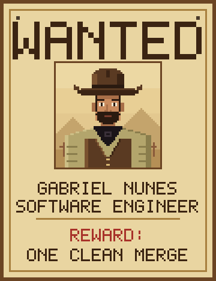
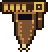
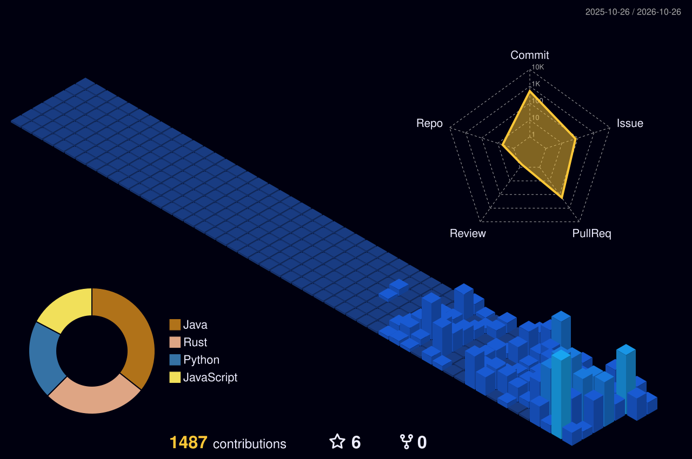
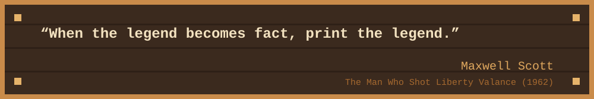

### Talk low, ship clean.

<table>
<tr>
<td width="300" align="center" valign="top">

 

</td>
<td valign="top">

###  The brand

Software engineering student from Goiânia, Brazil.

I build with **Java**, **Spring Boot** and **Angular**, reach for **Rust** when a problem asks for it, and work close to applied metrology, where a measurement is only as good as the code behind it.

I like code that does its job without making noise.

**Portfolio:** [gabrielviananunes.github.io](https://gabrielviananunes.github.io)

</td>
</tr>
</table>

###  The holster

**Focus:** full stack development, REST APIs, process automation, systems integration and software architecture. 
**Spoken languages:** Portuguese (native), English (fluent), Spanish (advanced), German (A2).

###  The town

###  Words to ride by

A new one every Monday.

