# Seasonal gallery

How the overview looks on each special date, shown here at any time of the year. The pictures below are only previews. The profile itself wears a decoration only inside that date's own window, and looks normal every other day.

## Halloween

On the overview: 24 Oct to 2 Nov (example for 2027).



 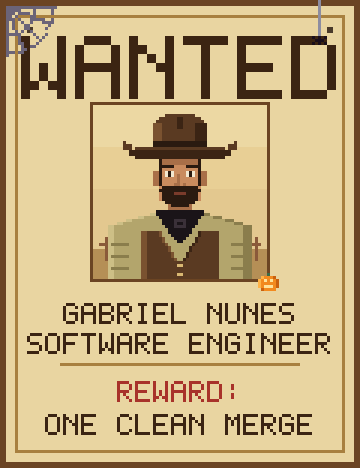

## Christmas

On the overview: 3 Nov to 25 Dec (example for 2027).



 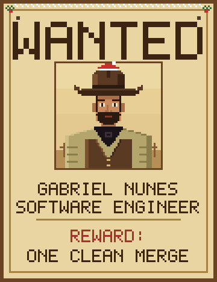

## Birthday

On the overview: 28 Dec (example for 2027).



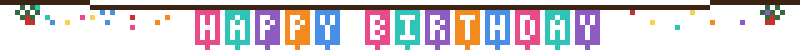

 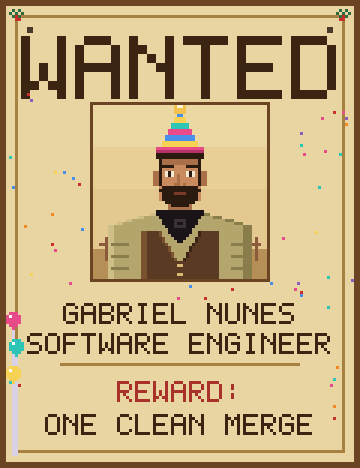

## New Year

On the overview: 31 Dec to 1 Jan (example for 2027).



 

## Easter

On the overview: 25 Mar to 31 Mar (example for 2027).



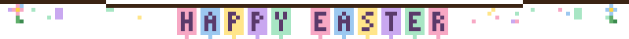

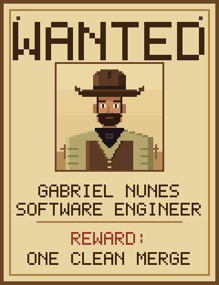 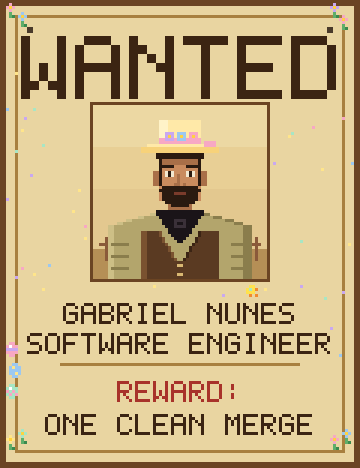

## National Day of the Cowboy

On the overview: 24 Jul (example for 2027).



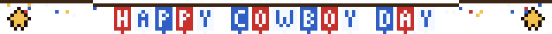

 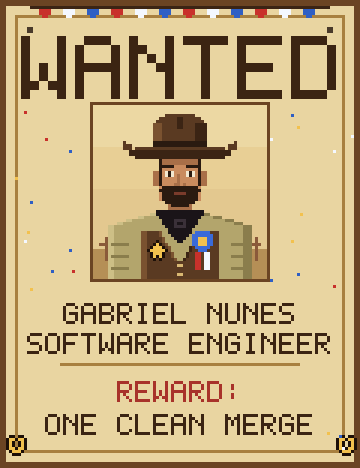

## Programmers' Day

On the overview: 13 Sep (example for 2027).



 

Regenerate with `python scripts/build_gallery.py`.
