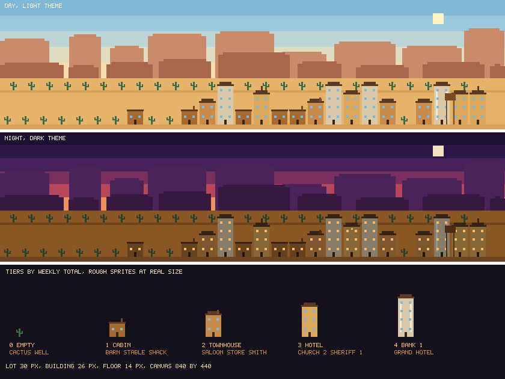

# Western town 3D: design

Output of issue 2. The mapping rules (weeks to buildings) are in `docs/wiki/Design-decisions.md`. This page fixes how the town looks.

The sheet is generated by `scripts/town_design_sheet.py` from the real weekly totals. Sprites in it are placeholders, the final art comes in issue 5.

## Look and feel

**2.5D side view with depth**, not a true isometric grid. Two rows of lots:

| Row | Weeks | Scale | Reading |
|---|---|---|---|
| Back street | the 26 oldest | 0.8, a bit hazier | The past, further away |
| Front street | the 27 newest | 1.0 | Recent work, closest to you |

Reasons: it stays readable on a phone, the SVG stays small, and it matches the banner and footer. Isometric is possible later if this feels too flat.

**Follows the viewer's theme.** The SVG switches palette with `prefers-color-scheme`: dusk for dark mode, daylight for light mode. Windows are lit only at night.

## What lives in the town

Buildings by tier (decided by the weekly total, see the mapping table):

| Tier | Floors | Buildings |
|---|---|---|
| 0, empty week | 0 | Empty lot with a cactus, hitching post, wagon, barrels or a well |
| 1 | 1 | Old western cabin (most common), barn, stable, shack (all repeatable) |
| 2 | 2 | Two story townhouse, saloon, general store, blacksmith (all repeatable) |
| 3 | 3 | Hotel (repeatable), old church (at most 2), sheriff office (only 1) |
| 4 | 4 | Bank (only 1), grand hotel (repeatable) |

### Uniqueness rules

A real western town has one sheriff and one bank, so those never repeat.

| Building | How many | Where |
|---|---|---|
| Sheriff office | exactly 1 | The tier 3 lot closest to the middle of the town. Falls back to a tier 2 lot |
| Bank | exactly 1 | The most recent tier 4 week |
| Old church | up to 2 | The first and the last tier 3 lots, the edges of town. Only 1 if there are fewer than 3 tier 3 lots |
| Water tower | exactly 1 | Behind the busiest week |
| Everything else | any number | Rotates by week position so the street stays stable |

### Where the old western houses go

Houses are homes, so they follow quiet and moderate weeks and fill the outskirts of the street:

| Tier | Share of the rotation | Look |
|---|---|---|
| 1 | 3 of 6 are cabins | Single story wood cabin, pitched roof, chimney, porch |
| 2 | 2 of 5 are townhouses | Two story wood house, balcony, chimney, shutters |

Busy weeks (tier 3 and 4) never become plain houses: they hold the hotel, church, sheriff office and bank, so the center of the street reads as the commercial heart of the town.

Check with the real data of 2026-10-15: 1 sheriff, 1 bank, 2 churches, 4 barns, 1 stable, 3 stores, 1 blacksmith, 1 hotel and 3 grand hotels.

Landmarks and scenery:

| Element | Rule |
|---|---|
| Water tower | Stands behind the busiest week |
| Old church | One of the tier 3 types, with a steeple and a cross |
| Lit window | The current week at night |
| Mesas and mountains | Far layer, from the banner palette |
| Telegraph poles and fence | Between the two streets, a few of each |
| Rider on a horse | The banner cowboy crossing the front street |
| Tumbleweed | Rolls along the street, as in the banner |
| Train on the horizon | Optional, only if the size budget allows |

Not in v1, tracked as future improvements (issues with the `future` label): cemetery, windmill, a train on the horizon, a year selector for older towns and an isometric view.

## Canvas and sizes

| Item | Value |
|---|---|
| Canvas | 840 by 440 grid pixels, 1 grid pixel is 1 SVG unit |
| Lot pitch | 30 |
| Building width | 26 (21 in the back row) |
| Floor height | 14 |
| Tier heights, front row | 22, 36, 50, 64 |
| Church steeple | +14 above tier 3 |
| Water tower | 18 wide, 52 tall |
| Street bands | back street at y 150, front street at y 207 in each panel |

## Palette

| Role | Day | Night |
|---|---|---|
| Sky | `#7fb8d6`, `#9cc8de`, `#bcd6d8`, `#e0dcc0`, `#f6dcae` | `#1b1030`, `#2a1745`, `#46225a`, `#7a2f5e`, `#b8465a`, `#f0905a` |
| Far mesas | `#c98b6a` | `#4a2358` |
| Near mesas | `#a8664c` | `#37193f` |
| Ground | `#e6b36a` | `#8a5624` |
| Street | `#d9a25a` | `#6f4420` |
| Window glass | `#7fb8d6` | `#f7b867` (lit) |
| Sun or moon | `#fff3c4` | `#f3e2c0` |

Buildings share one base color per tier in daylight (`#a6692f`, `#c98b4a`, `#d9a85a`, `#d9c9a8`). The night version is the same color at 62 percent brightness, so one set of sprites serves both themes.

## Size budget

The first rough sheet written pixel by pixel weighs 246 KB. That is too close to the 300 KB limit for the final file, so the final renderer must:

- define each building once and place it with `<use>`;
- draw big flat areas (sky, ground, mesas) as single rectangles;
- keep window lights as a small shared pattern.

Target: under 120 KB for the daily file.

## Confirmed decisions

1. The 2.5D two street layout stays. Isometric is a future improvement.
2. At most two churches, only one sheriff office and one bank. Repetition happens with hotels, stables, barns, stores and similar buildings.
3. A stable is part of the set.

## Future improvements

| Idea | Why it waits |
|---|---|
| Train on the horizon | Needs size budget left over after the sprites |
| Cemetery | New sprite and a rule for where it goes |
| Windmill | Same, a tier 1 variant |
| Year selector | Needs a second data fetch and a UI in the README |
| Isometric view | A different renderer, only if 2.5D feels too flat |
